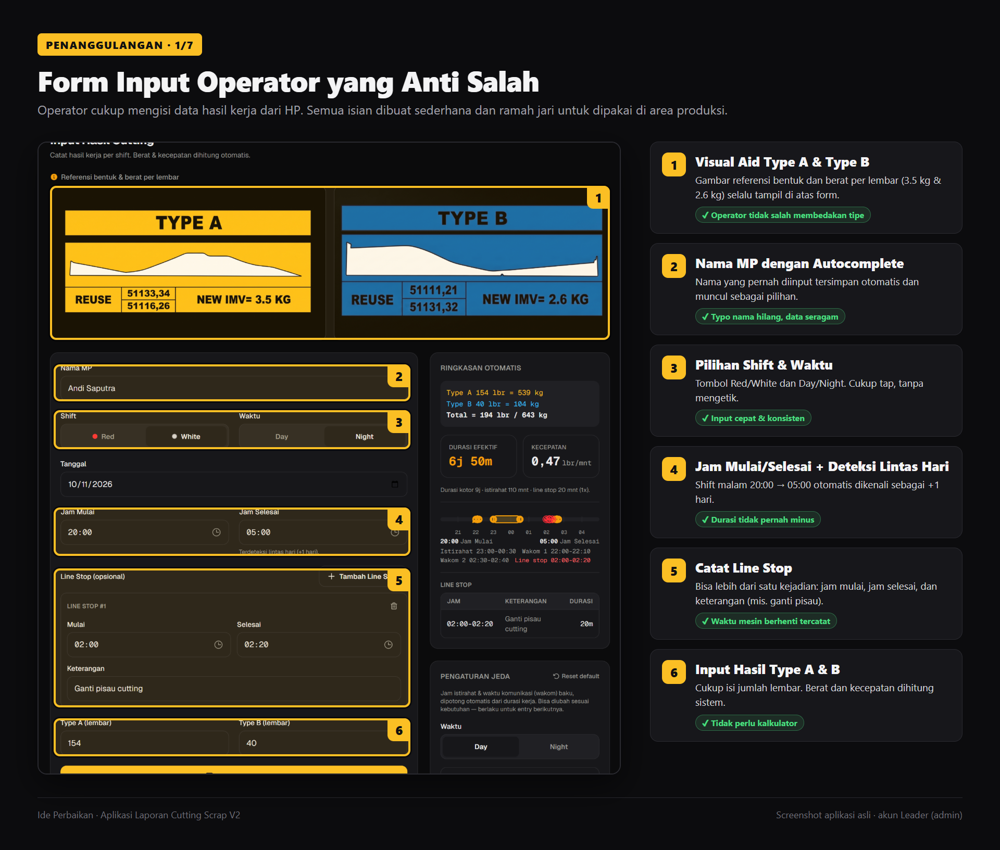
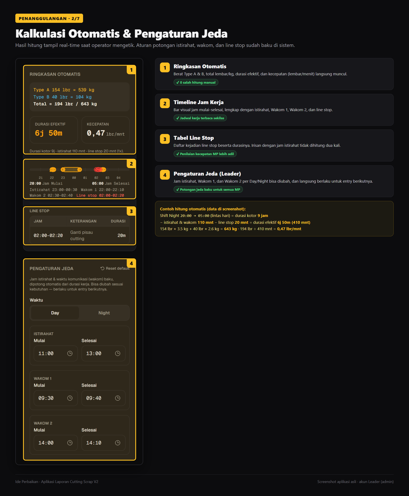
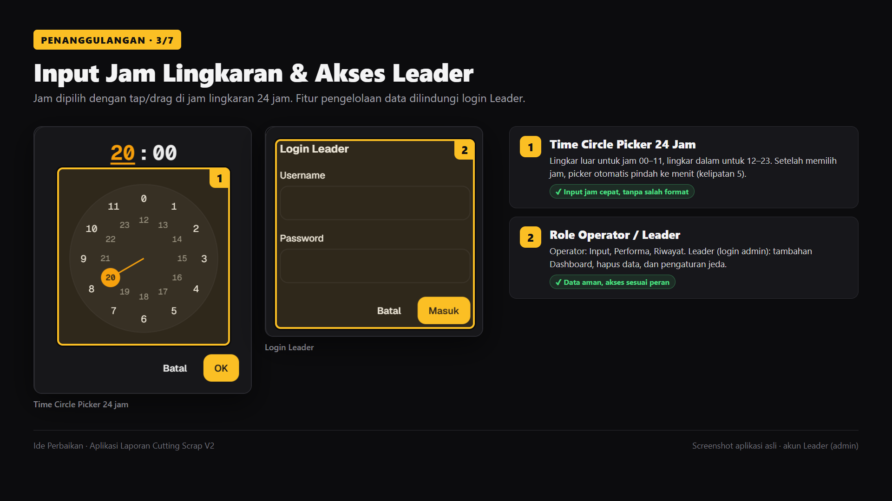
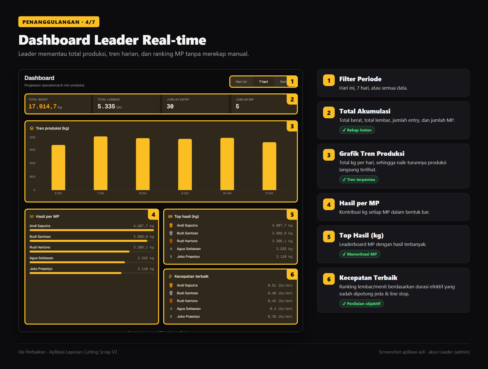
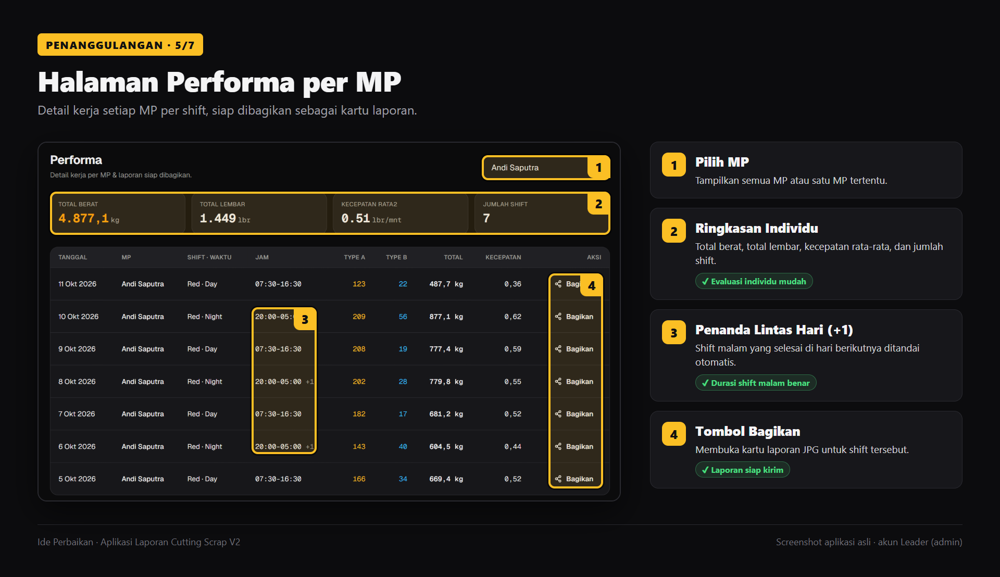
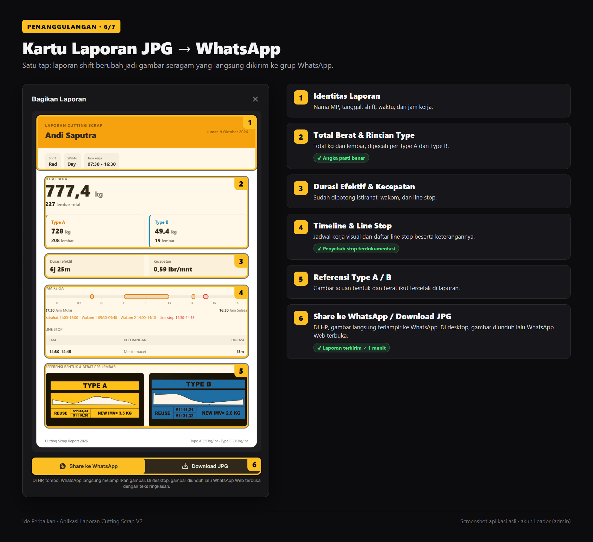
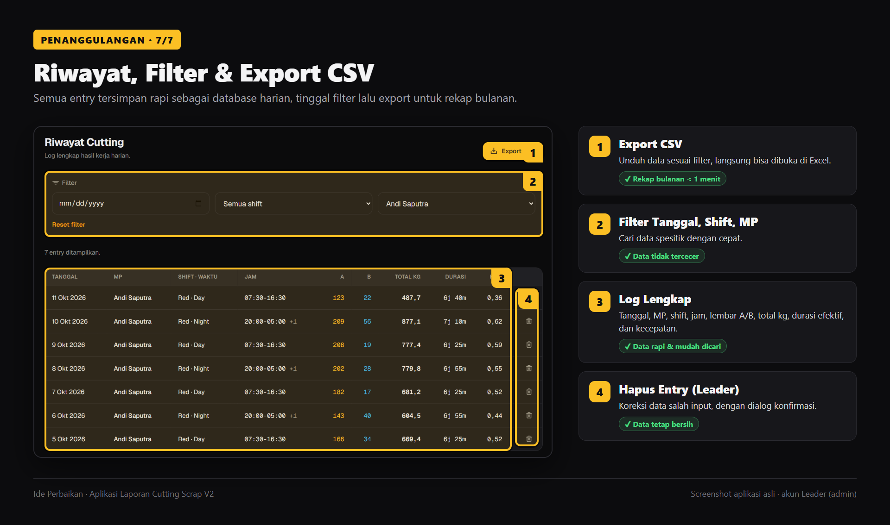
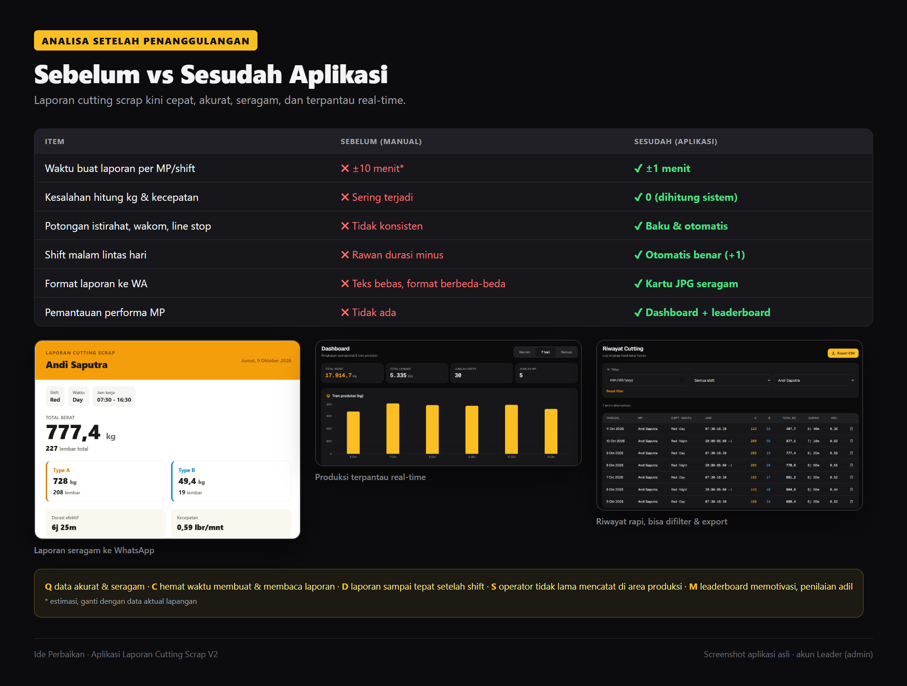

# IDE PERBAIKAN

## Judul

**Digitalisasi Laporan Cutting Scrap: Aplikasi Web untuk Hitung Berat, Kecepatan MP, dan Kirim Laporan ke WhatsApp secara Otomatis**

> Catatan: angka bertanda *(estimasi)* adalah perkiraan. Ganti dengan data aktual dari lapangan sebelum dipresentasikan.

---

## 1. Latar Belakang Masalah

Proses *cutting scrap* menghasilkan dua jenis potongan, yaitu **Type A (3.5 kg/lembar)** dan **Type B (2.6 kg/lembar)**. Setiap shift, operator (MP) wajib melaporkan hasil kerjanya ke leader: jumlah lembar, berat total, jam kerja, dan kecepatan cutting.

Selama ini pelaporan dilakukan **secara manual**:

- Operator mengetik laporan hasil kerja sebagai teks bebas di grup WhatsApp.
- Berat dan kecepatan dihitung manual memakai kalkulator.
- Durasi kerja dipotong waktu istirahat dan wakom (waktu komunikasi) berdasarkan ingatan.
- Leader merekap ulang semua laporan ke Excel untuk laporan harian, mingguan, dan bulanan.

Cara ini lambat, rawan salah hitung, dan data performa MP sulit dipantau secara *real-time*.

---

## 2. Analisa Masalah

| Aspek | Kondisi Saat Ini | Dampak |
|---|---|---|
| **Man** | Operator menghitung kg dan kecepatan sendiri. Kemampuan hitung dan ketelitian tiap orang berbeda. | Hasil hitung antar MP tidak seragam dan sering salah. |
| **Method** | Tidak ada standar potongan istirahat, wakom, dan line stop. Shift malam lintas hari dihitung manual. | Durasi efektif salah, sehingga kecepatan MP tidak akurat (bisa minus atau terlalu besar). |
| **Material (Data)** | Data hanya berupa teks chat WA dengan format berbeda-beda, dan nama MP sering salah ketik. | Data tercecer, susah dicari, dan rekap bulanan memakan waktu lama. |
| **Machine (Tools)** | Belum ada alat bantu digital, hanya kalkulator dan chat WhatsApp. | Tidak ada dashboard, tren, ataupun ranking performa. |
| **Environment** | Area produksi bising dan sibuk, sementara laporan dibuat di akhir shift saat operator sudah lelah. | Laporan terlambat dan detail line stop sering lupa dicatat. |

---

## 3. Detail Masalah

1. **Salah hitung berat**: konversi lembar ke kg (×3.5 dan ×2.6) dihitung manual, sehingga sering terjadi selisih.
2. **Durasi efektif tidak akurat**: potongan istirahat (Day 11:00–13:00, Night 23:00–00:30), Wakom 1, dan Wakom 2 sering lupa dikurangi atau dikurangi dua kali.
3. **Shift malam lintas hari**: shift 20:00 → 05:00 menghasilkan durasi minus atau salah apabila dihitung manual.
4. **Line stop tidak tercatat**: waktu mesin berhenti (macet, ganti pisau, dll.) tidak dikurangi dari durasi kerja, sehingga kecepatan MP terlihat rendah padahal penyebabnya mesin.
5. **Laporan lambat dan tidak seragam**: laporan ke grup WA berupa teks bebas dengan format berbeda-beda tiap orang, sehingga sulit dibaca dan dibandingkan.
6. **Rekap memakan waktu**: leader harus menyalin ulang data ke Excel, sekitar *(estimasi)* **±60 menit/hari**.
7. **Tidak ada visibilitas performa**: tidak ada dashboard total produksi, tren, atau ranking MP terbaik.

---

## 4. Root Cause (Akar Masalah)

Dianalisa menggunakan metode **5 Why**:

| Why | Jawaban |
|---|---|
| Kenapa laporan cutting sering salah dan lambat? | Karena semua perhitungan dan pelaporan dilakukan manual. |
| Kenapa perhitungan manual sering salah? | Karena aturannya kompleks: konversi 2 tipe, 3 window jeda per Day/Night, line stop, dan shift lintas hari. |
| Kenapa aturan kompleks itu dihitung manusia? | Karena tidak ada alat yang menyimpan aturan tersebut secara baku. |
| Kenapa data sulit direkap dan dipantau? | Karena data tidak tersimpan terpusat dengan format yang seragam. |
| Kenapa tidak tersimpan terpusat? | **Belum ada sistem digital untuk input, kalkulasi, penyimpanan, dan pelaporan hasil cutting scrap.** |

**Root cause:** tidak ada sistem digital terstandar. Akibatnya aturan hitung (berat, jeda, line stop, lintas hari) bergantung pada manusia, dan data tidak tersimpan terpusat.

---

## 5. Penanggulangan

Dibuat **Aplikasi Web Cutting Scrap V2** yang *mobile-first* (bisa dipakai lewat HP di area produksi), dengan fitur:

| No | Fitur | Mengatasi Masalah |
|---|---|---|
| 1 | **Form Input + Visual Aid Type A / Type B**: gambar referensi bentuk dan berat per lembar tampil di atas form. | Operator tidak salah membedakan tipe. |
| 2 | **Autocomplete Nama MP**: nama tersimpan dari input sebelumnya. | Typo nama hilang dan data seragam. |
| 3 | **Time Circle Picker 24 jam**: jam mulai dan selesai dipilih dengan tap/drag di jam lingkaran. | Input jam cepat dan ramah jari. |
| 4 | **Auto-Calculate real-time**: berat A/B, total lembar, total kg, durasi efektif, dan kecepatan (lembar/menit) langsung muncul. | Tidak ada lagi salah hitung manual. |
| 5 | **Pengaturan Jeda (Istirahat, Wakom 1, Wakom 2)** per Day/Night, bisa diubah leader. | Potongan jeda baku dan konsisten untuk semua MP. |
| 6 | **Line Stop**: catat beberapa kejadian (jam mulai–selesai + keterangan). Irisan dengan jam istirahat otomatis tidak dihitung ganda. | Kecepatan MP adil dan tidak terbebani masalah mesin. |
| 7 | **Penanganan Shift Lintas Hari** otomatis (mis. 20:00 → 05:00). | Durasi tidak pernah minus. |
| 8 | **Work Timeline**: visual bar jam kerja, istirahat, wakom, dan line stop. | Leader melihat jadwal kerja sekilas. |
| 9 | **Kartu Laporan JPG + Share ke WhatsApp**: berisi nama MP, tanggal, shift, jam kerja, total kg/lembar, kecepatan, timeline, dan line stop. | Laporan seragam, rapi, dan terkirim dalam hitungan detik. |
| 10 | **Dashboard Leader**: total akumulasi, grafik tren produksi, hasil per MP, serta leaderboard hasil dan kecepatan. | Performa terpantau *real-time*. |
| 11 | **Halaman Performa**: tabel per MP beserta kartu laporannya. | Evaluasi individu mudah. |
| 12 | **Riwayat + Filter + Export CSV**: filter tanggal, shift, dan MP, lalu ekspor ke Excel. | Rekap bulanan instan tanpa ketik ulang. |
| 13 | **Role Operator / Leader (login)**: dashboard dan kelola data hanya untuk leader. | Data aman dan akses sesuai peran. |

**Ilustrasi fitur (screenshot aplikasi, akun Leader):**









**Alur kerja baru:**

```
Operator buka app di HP → isi Nama, Shift, Jam, Lembar A/B, Line Stop
        ↓ (otomatis)
Hitung kg + durasi efektif + kecepatan → tersimpan ke Riwayat
        ↓
Generate kartu JPG → Share ke grup WhatsApp
        ↓
Leader pantau Dashboard → Export CSV untuk rekap bulanan
```

---

## 6. Analisa Setelah Penanggulangan

| Item | Sebelum | Sesudah |
|---|---|---|
| Waktu buat laporan per MP per shift | ±10 menit *(estimasi)* | **±1 menit** |
| Kesalahan hitung kg / kecepatan | Sering terjadi | **0, dihitung sistem** |
| Potongan istirahat, wakom, line stop | Tidak konsisten | **Baku dan otomatis** |
| Shift malam lintas hari | Rawan durasi minus | **Otomatis benar** |
| Format laporan ke WA | Teks bebas, format berbeda-beda | **Kartu JPG seragam** |
| Pemantauan performa MP | Tidak ada | **Dashboard + leaderboard real-time** |



**Efek tidak langsung (Q-C-D-S-M):**

- **Quality**: data akurat dan seragam, bisa dipakai sebagai dasar evaluasi MP.
- **Cost**: hemat waktu operator dan leader dalam membuat serta membaca laporan.
- **Delivery**: laporan sampai ke leader tepat setelah shift selesai.
- **Safety**: operator tidak lama berdiri mencatat manual di area produksi.
- **Morale**: leaderboard memotivasi MP, dan line stop tercatat sehingga penilaian lebih adil.

**Rencana lanjutan (standarisasi):**

1. Pindahkan penyimpanan dari `localStorage` ke database terpusat (mis. Supabase) agar data dari semua HP tergabung.
2. Sosialisasi dan training operator, lalu jadikan aplikasi ini standar laporan resmi.
3. Evaluasi 1 bulan: bandingkan data aktual sebelum dan sesudah untuk mengganti angka estimasi di atas.

---

## Lampiran: Prompt Ilustrasi (Higgsfield)

Gunakan model `gpt_image_2_5` atau `nano_banana_pro` (bagus untuk teks), rasio 16:9.

**Gambar 1: Kondisi Sebelum**
> Clean flat vector infographic illustration, Indonesian factory theme. Title at top: "SEBELUM: Pencatatan Cutting Scrap Manual". A busy metal scrap cutting area: a tired operator in safety helmet and gloves typing a long messy text report on a smartphone WhatsApp chat, a leader holding a calculator looking confused at a phone full of unformatted WhatsApp text reports. Small red callout labels: "Hitung manual kg & kecepatan", "Potongan istirahat sering salah", "Shift malam lintas hari error", "Line stop tidak tercatat", "Laporan lambat ke grup WA", "Data tercecer, sulit rekap". Muted colors with red warning accents, white background, crisp readable text.

**Gambar 2: Root Cause (Fishbone)**
> Clean flat infographic of an Ishikawa fishbone diagram, title "ROOT CAUSE: Laporan Cutting Scrap Salah & Lambat". Fish head (red box): "Laporan salah & lambat". Bones labeled: "Man: hitung manual, beda ketelitian", "Method: jeda & line stop tidak baku", "Material: teks WA tidak seragam, nama typo", "Machine: hanya kalkulator & chat WA", "Environment: bising, lelah akhir shift". Navy and orange palette, white background, crisp readable text.

**Gambar 3: Fitur Aplikasi**
> Modern flat infographic showcasing a mobile web app "Cutting Scrap V2", title "PENANGGULANGAN: Aplikasi Cutting Scrap". Center: a smartphone showing an input form with Type A / Type B reference images and a 24-hour circular time picker. Around it, 8 rounded feature cards with icons: "Auto hitung kg & kecepatan", "Istirahat & Wakom otomatis", "Catat Line Stop", "Shift lintas hari", "Timeline jam kerja", "Share JPG ke WhatsApp", "Dashboard & Leaderboard", "Riwayat & Export CSV". Clean blue and green palette, white background, crisp readable text.

**Gambar 4: Sesudah (Before vs After)**
> Split-screen flat vector illustration, left side labeled "SEBELUM" (gray, messy WhatsApp text messages, calculator, stressed operator, clock showing 10 menit), right side labeled "SESUDAH" (bright, operator smiling holding smartphone, WhatsApp report card with "Total 539 kg" and "Kecepatan 1.2 lbr/menit", leader viewing dashboard chart on laptop, clock showing 1 menit). Bottom row of green check badges: "0 salah hitung", "Laporan 1 menit", "Format seragam", "Terpantau real-time". White background, crisp readable text.
